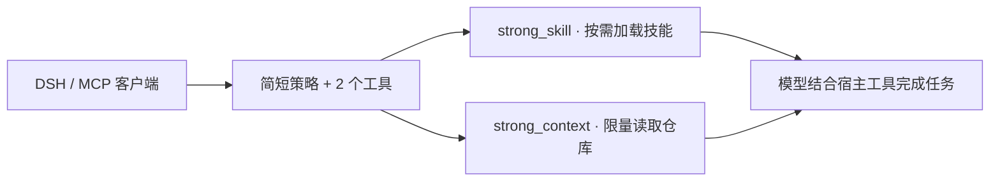

<div align="center">

# dsh-strong-skills

**让方法按需到场，让上下文保持轻量。**  
On-demand skills. Bounded context. Built for DeepSeek Harness.

[](https://nodejs.org/)
[](https://github.com/wemebabo57-a11y/dsh-mcp-strong-and-skills/actions/workflows/ci.yml)
[](LICENSE)
[](package.json)
[](test)

[快速开始](#快速开始) · [能力一览](#能力一览) · [MCP 接入](#mcp-接入) · [上下文预算](#上下文预算) · [参与贡献](#参与贡献)

</div>


面向 [DeepSeek Harness](https://github.com/deepseek-ai/deepseek-harness) 的轻量编码增强插件。通过 **8 个按需技能、2 个工具入口**，补足交付方法、仓库上下文和设计指导；同时提供独立的 **stdio MCP 服务**，可接入其他 MCP 客户端。

模型继续使用宿主当前 profile 启用的编辑、终端、联网、浏览器与子代理工具。本插件在本地加载技能、检索文件，不在后台发起模型请求。

> **验证状态：** 本地 52 项测试覆盖技能路由、原生宿主契约模拟和真实 stdio 子进程通信。原生插件尚未在真实 DSH 实例中完成端到端验证；支持依据与版本边界见[兼容性记录](docs/compatibility.md)。

## 快速开始

需要 **Node.js 24.9+**；接入原生插件还需已安装 DSH。源码可直接运行，无需构建或 `npm install`。

### 直接从 GitHub 安装（推荐）

已有 `dsh` 命令时，可以直接从本仓库拉取并安装，无需先手动克隆：

```sh
# 下载仓库，并把插件加入 web profile
dsh plugin --profile web add github:wemebabo57-a11y/dsh-mcp-strong-and-skills

# 检查配置中出现 strong-skills / dsh-strong-skills
dsh --profile web --dump-config

# 启动；已有 DSH 进程请先退出再重新启动
dsh web --profile web
```

这是 [DSH 官方支持的 GitHub 安装方式](https://github.com/deepseek-ai/deepseek-harness/blob/master/docs/user/develop/basic/publish.md#installing-from-github-the-build-script-catch)。DSH 会下载源码、安装包并加载其 `dsh.bundle` 配置；本项目入口是可直接运行的 `.mjs`，不需要编译。仓库名是 `dsh-mcp-strong-and-skills`，安装后的包名是 **`dsh-strong-skills`**。

使用其他 profile 时，将以上三条命令中的 `web` 一起替换为实际名称。插件安装在 profile 中，不需要在每个代码项目里重复安装。

需要固定代码版本时，可在仓库来源后追加 `#提交SHA`，例如安装已发布的初始代码提交：

```sh
dsh plugin --profile web add github:wemebabo57-a11y/dsh-mcp-strong-and-skills#ebbe74359123ddf4c6cf6559a31abea2674eaa64
```

卸载时使用包名，然后重启对应 profile：

```sh
dsh plugin --profile web remove dsh-strong-skills
```

### 本地体验与源码安装

想先检查源码、体验 CLI 或参与开发时，可以手动克隆后安装本地目录：

```sh
git clone https://github.com/wemebabo57-a11y/dsh-mcp-strong-and-skills.git
cd dsh-mcp-strong-and-skills

# 先在本地体验技能与仓库检索
node bin/strong.mjs skill --query "排查登录报错并修复"
node bin/strong.mjs inspect --root . --action map --limit 30

# 将本地插件安装到 web profile，然后检查并启动
dsh plugin --profile web add .
dsh --profile web --dump-config
dsh web --profile web
```

安装命令会修改所选 DSH profile。原生模式会在每次调用时解析 **DSH 当前会话的工作目录**，适合多项目使用与目录切换。

若想先用临时覆盖配置试用，在仓库目录执行：

```sh
node bin/strong.mjs config --mode native --root . > strong.native.patch.yml
dsh web --patch /absolute/path/to/strong.native.patch.yml
```

将 `/absolute/path/to/…` 替换为本机绝对路径；Windows 可用 `C:/path/to/…`。生成配置只创建本地 patch，不改 DSH 用户配置。已安装原生插件时，不要再叠加同一原生 patch。原生模式中的 `--root` 仅验证目录，不固定会话目录。

## 能力一览

### 8 个按需技能

| 技能 | 帮助模型完成什么 |
| --- | --- |
| `code-delivery` | 理解现有实现、检查接口，按验收依据交付功能 |
| `debug` | 复现问题、缩小范围、定位根因，验证回归修复 |
| `refactor` | 保护已有行为，控制迁移范围与兼容性 |
| `testing` | 按风险选择测试，覆盖可观察行为与失败路径 |
| `frontend-design` | 根据内容确定布局、配色、交互和可访问性 |
| `security-review` | 按任务需要检查输入、权限与数据边界 |
| `performance` | 测量瓶颈，以前后证据评估优化 |
| `research` | 查阅官方文档，核对版本与技术适配 |

`strong_skill` 无参数时只列目录；`id` 精确读取技能，`query` 通过本地关键词匹配，默认只读最相关的一个。显式传 `limit: 2` 可读取两个，仍受 profile 限制。无匹配时返回简短目录，交由模型选择；已加载的正文保留在会话历史中。

前端技能优先尊重用户要求与现有品牌。新界面默认避免深蓝底、蓝紫渐变、无意义光晕和重复的大标题卡片，鼓励根据内容选择视觉方向。这些是指令与启发式建议，不能保证模型每次都遵守。

### 2 个工具入口

| 工具 | 调用方式 | 返回内容 |
| --- | --- | --- |
| `strong_skill` | `id` / `query` / 无参数 | 指定技能、相关技能或简短目录 |
| `strong_context` | `action: "map"` | 限量文件列表与文件类型计数 |
| ↳ | `action: "search"` | 字面关键词匹配的文件、行号与片段 |
| ↳ | `action: "read"` | 指定文件从 `start` 行开始的片段 |
| ↳ | `action: "diff"` | Git 工作树中未暂存的跟踪文件差异 |
| ↳ | `action: "checks"` | 已有项目脚本与验证配置，供模型选择执行 |
| ↳ | `action: "style"` | 常见默认配色与渐变的启发式建议，附文件位置 |

原生工具的参数示例：

```json
{"query": "排查登录报错并修复", "limit": 1}
```

上面的参数传给 `strong_skill`；下面的参数传给 `strong_context`：

```json
{"action": "search", "path": "src", "query": "StrongEngine", "limit": 10}
```

## MCP 接入

原生插件和 MCP 接入选择一种即可，避免重复工具与指令。

**DSH 内置 MCP 桥：** 在仓库目录生成配置，将 `--root` 指向目标项目。生成结果会填入当前 Node 与插件入口的绝对路径。

```sh
node bin/strong.mjs config --mode mcp --root /absolute/path/to/your-project > strong.mcp.patch.yml
dsh web --patch /absolute/path/to/strong.mcp.patch.yml
```

官方桥将工具命名为 `mcp__strong__strong_skill` 和 `mcp__strong__strong_context`，详见 [DSH MCP 桥文档](https://github.com/deepseek-ai/deepseek-harness/blob/master/packages/mcp/mcp-client/README.md)。

**其他 MCP 客户端：** 参考[完整配置示例](examples/mcp-client.json)，将以下路径替换为本机绝对路径：

```json
{
  "mcpServers": {
    "strong": {
      "command": "node",
      "args": ["/absolute/path/to/dsh-mcp-strong-and-skills/bin/strong.mjs",
               "serve", "--root", "/absolute/path/to/your-project", "--profile", "lean"]
    }
  }
}
```

完成协议初始化后，客户端可发送以下 `tools/call` 请求：

```json
{
  "jsonrpc": "2.0", "id": 1, "method": "tools/call",
  "params": {"name": "strong_skill", "arguments": {"id": "debug"}}
}
```

服务只读取启动时指定的项目根目录；切换项目需重启服务。stdout 专用于 JSON-RPC，诊断写入 stderr。支持 tools、resources 与 `strong://skills/<id>` 技能资源；支持协商 `2025-11-25`、`2025-06-18`、`2025-03-26`、`2024-11-05` 协议版本。

## 上下文预算

常驻内容只有简短策略与两个工具 schema，**不预载技能正文**。当前字符启发式估算约 **606 tokens**，可运行 `npm run budget` 复算。该数字不是 DeepSeek tokenizer 结果或账单测量，不包含宿主上下文、MCP 名称前缀与包装；实际开销与节省效果需在真实任务中测量。

| Profile | 单次结果字符上限 | 最多扫描文件 | 每次最多加载技能 |
| --- | ---: | ---: | ---: |
| `lean` | 4,000 | 400 | 1 |
| `balanced`（默认） | 6,000 | 800 | 2 |
| `thorough` | 12,000 | 2,000 | 2 |

表中上限是 **字符数**。默认检索只返回片段；过长结果保留合法 JSON 并标注截断，模型应缩小范围或按行读取。

原生插件配置还支持 `maxOutputChars`（2,000–20,000）、`maxFiles`（20–5,000）、`maxFileBytes`（1,024–262,144）、`maxSkillLoads`（1–2）。通过 `brandIntent` 描述既有品牌，或设置 `allowBrandColors: true`，可让样式检查尊重品牌配色。CLI 仅暴露 profile 切换，完整字段通过 DSH patch 配置。

## 工作方式与边界



- 仓库工具只读，不执行项目脚本或任意命令。`checks` 返回的建议由模型结合任务与宿主权限决定是否执行。
- 默认排除生成目录、二进制、大文件和常见敏感路径，拒绝目录穿越与符号链接。Git 可用时遵循其 ignore 规则，否则明确说明仅使用内置排除规则。普通源码中的敏感信息仍可能被读取。
- `diff` 不含暂存区或未跟踪文件；不支持的 Git 环境会返回原因。`style` 是启发式建议，不是 CSS 解析器或品牌判定器。
- 插件不会安装外部 MCP 服务、改变模型权限或替代 DSH 的安全边界。

## 开发与验证

```sh
node bin/strong.mjs skill --id frontend-design
node bin/strong.mjs inspect --root . --action read --path package.json --start 1 --limit 20
node bin/strong.mjs inspect --root . --action checks
npm run check
npm test
npm run budget
```

测试覆盖中英文技能路由、原生宿主契约模拟、真实 stdio 子进程往返、路径边界、取消与输出上限。本地检查不等于真实 DSH 集成测试或模型能力评测。DSH 契约参考版本、上游链接与待验证项目见[兼容性记录](docs/compatibility.md)。

运行 `npm pack` 可生成本地分发 tarball；打包前会自动执行静态检查和测试。源码无需编译或安装脚本。

## 参与贡献

欢迎通过 [Issues](https://github.com/wemebabo57-a11y/dsh-mcp-strong-and-skills/issues) 提交复现步骤、兼容性反馈或技能建议，也欢迎提交 Pull Request。修改后请运行 `npm run check` 与 `npm test`；涉及预算或工具 schema 时，再运行 `npm run budget`。更多说明见[贡献指南](CONTRIBUTING.md)；漏洞报告方式见[安全说明](SECURITY.md)。

本项目采用 [MIT License](LICENSE)。
