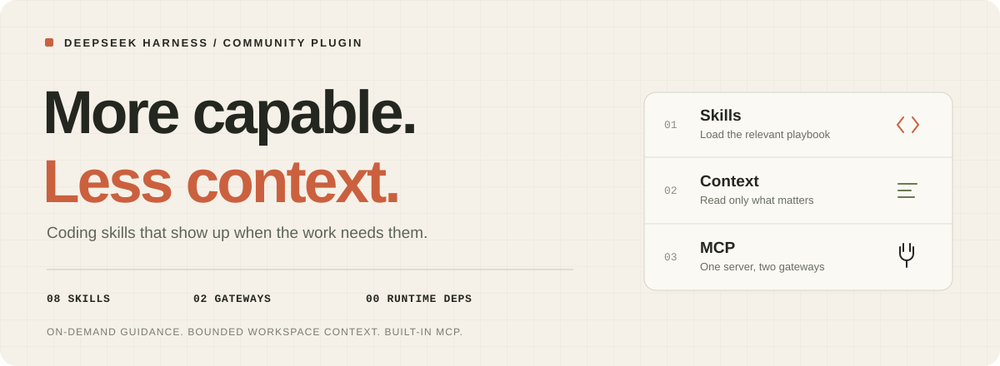
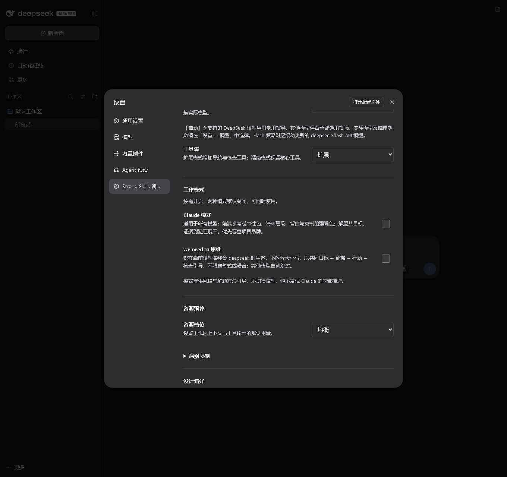
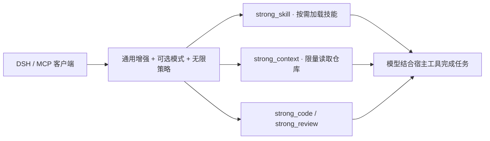

<div align="center">

# dsh-strong-skills

**方法按需到场，上下文按任务展开。**<br>
On-demand skills. Bounded by default. Unlimited when you ask.

[](https://nodejs.org/)
[](https://github.com/wemebabo57-a11y/dsh-mcp-strong-and-skills/actions/workflows/ci.yml)
[](LICENSE)
[](package.json)
[](test)

[快速开始](#快速开始) · [插件设置](#插件设置) · [三种增强模式](#三种增强模式) · [能力一览](#能力一览) · [MCP 接入](#mcp-接入) · [上下文预算](#上下文预算)

</div>



面向 [DeepSeek Harness](https://github.com/deepseek-ai/deepseek-harness) 的编码增强插件。**所有模型共享通用增强，DeepSeek V4 Pro 与 V4.1 Flash 1017 再获得专用工作策略；需要时可以开启完全不省 token 的无限模式。** 内置 8 个按需技能、4 个工具入口、可关闭的增强思考，以及独立的 stdio MCP 服务。

**0.3.0 是本轮功能更新：**
- **修复 we need to 思维**：旧版只有在模型名含 `deepseek` 且增强思考开启时才注入，其他模型或关闭增强思考后勾选确实没有效果。现在只取决于该开关，所有模型、增强思考关闭时都生效，并明确要求先写下 `We need to …` 目标，再展开证据、行动与验证。
- **提升通用能力**：强化契约核对、最小完整改动、失败边界、自审与按证据验证；Pro/Flash 策略同步加强。
- **新增无限 token 模式**：取消本插件默认的输出与读取截断，开放全部工具和最多 8 个技能正文，要求完整规划、完整实现与尽可能全面的验证。它不是“少用 token”的档位，而是主动用更多消耗换完整性。

模型继续使用宿主当前 profile 启用的编辑、终端、联网、浏览器与子代理工具。本插件在本地加载技能、检索文件，不在后台发起模型请求。

> **验证状态：** 116 项自动化测试通过；另有 9 项基于真实 DSH rc.5 组件的集成检查，覆盖最终提示词、当前模型切换、多会话隔离、实时开关、完整自定义提示词与无限模式策略。没有发起模型生成或付费模型请求，也未进行模型能力基准评测。详见[兼容性记录](docs/compatibility.md)。

## 快速开始

需要 **Node.js 24.9+**；原生插件要求 **DSH 0.2.1-rc.3 或同一兼容版本范围内的更新版本**。CLI/MCP 无第三方运行依赖；原生设置复用宿主提供的 Schemastery 配置库。浏览器分发文件已提交，安装时无需构建。旧宿主应先升级，以获得 volatile Config 与当前客户端插槽。

### 直接从 GitHub 安装（推荐）

确保 `dsh` 和 `pnpm` 都在 PATH 中（可先运行 `dsh --help` 与 `pnpm --version` 检查），即可直接从本仓库拉取并安装，无需先手动克隆：

```sh
# 下载仓库，并把插件加入 web profile
dsh plugin --profile web add github:wemebabo57-a11y/dsh-mcp-strong-and-skills

# 检查配置中出现 strong-skills / dsh-strong-skills
dsh --profile web --dump-config

# 启动；已有 DSH 进程请先退出再重新启动
dsh --profile web
```

这是 [DSH 官方支持的 GitHub 安装方式](https://github.com/deepseek-ai/deepseek-harness/blob/master/docs/user/develop/basic/publish.md#installing-from-github-the-build-script-catch)。DSH 会下载源码、安装包并加载其 `dsh.bundle` 配置；本项目入口是可直接运行的 `.mjs`，不需要编译。仓库名是 `dsh-mcp-strong-and-skills`，安装后的包名是 **`dsh-strong-skills`**。

使用其他 profile 时，将以上三条命令中的 `web` 一起替换为实际名称。插件安装在 profile 中，不需要在每个代码项目里重复安装。从旧版升级时，重新执行 GitHub 安装命令并重启相同 profile。

需要固定版本时，可在仓库来源后追加发布标签或提交 SHA：

```sh
dsh plugin --profile web add github:wemebabo57-a11y/dsh-mcp-strong-and-skills#0.3.0
```

卸载时使用包名，然后重启对应 profile：

```sh
dsh plugin --profile web remove dsh-strong-skills
```

### 本地体验与源码安装

想先检查源码、体验 CLI 或参与开发时，可以手动克隆后安装本地目录：

```sh
git clone https://github.com/wemebabo57-a11y/dsh-mcp-strong-and-skills.git
cd dsh-mcp-strong-and-skills

# 先在本地体验技能与仓库检索
node bin/strong.mjs skill --query "排查登录报错并修复"
node bin/strong.mjs inspect --root . --action map --limit 30

# 将本地插件安装到 web profile，然后检查并启动
dsh plugin --profile web add .
dsh --profile web --dump-config
dsh --profile web
```

原生模式会在每次调用时解析 **DSH 当前会话的工作目录**，适合多项目使用与目录切换。

若想先用临时覆盖配置试用，在仓库目录执行：

```sh
node bin/strong.mjs config --mode native --root . > strong.native.patch.yml
dsh --profile web --patch /absolute/path/to/strong.native.patch.yml
```

将 `/absolute/path/to/…` 替换为本机绝对路径；Windows 可用 `C:/path/to/…`。生成配置只创建本地 patch，不改 DSH 用户配置。已安装原生插件时，不要再叠加同一原生 patch。原生模式中的 `--root` 仅验证目录，不固定会话目录。

## 插件设置

原生插件启用后，打开 **设置 → Strong Skills 编程增强**（英文界面显示 Strong Skills）。也可从 **插件 → dsh-strong-skills** 查看同一配置面板。更改通过 DSH 的 ConfigForms 保存至当前 profile，并在下一次请求/工具调用时读取；不使用浏览器本地存储代替宿主设置。表单保留只读、保存中、写入被拒绝和连接失败状态。

独立设置入口在浏览器客户端加载后立即注册，不等待宿主设置表单就绪。表单暂不可用时显示诊断提示，恢复后自动显示控件。



### 桌面端没有看到设置入口

桌面应用通常使用 **desktop profile**，终端示例中的 **web profile** 是另一个配置。安装到 web 不会替桌面应用安装插件。请在桌面侧栏的「插件」页面，确认 `dsh-strong-skills` 已安装并启用，然后通过「添加插件」重新安装当前来源：

```text
github:wemebabo57-a11y/dsh-mcp-strong-and-skills#main
```

安装完成后，完全退出并重新打开桌面应用，再打开「设置」，查找「Strong Skills 编程增强」。Desktop profile 由 Electron 应用管理，请从桌面端安装/更新。仅通过外部 MCP 客户端接入时，使用的是独立服务，不会给 DSH 桌面程序安装原生设置页。

| 设置 | 默认值 | 效果 |
| --- | --- | --- |
| 增强思考 | 开启 | 所有模型获得契约核对、依赖排序、最小完整改动、自审与按证据验证指导 |
| Claude 模式 | 关闭 | 所有模型可用；为前端任务提供简洁、温暖的设计方向；增强思考开启时再提供目标、证据与验证驱动的任务指导 |
| we need to 思维 | 关闭 | **所有模型生效，且独立于增强思考**：先写下 `We need to …` 目标，再按目标、事实、证据、行动、验证与风险展开 |
| 无限 token 模式 | 关闭 | **所有模型生效，且独立于增强思考**：取消本插件输出与读取预算，开放 4 个工具与最多 8 个技能正文，要求完整规划、实现与验证 |
| 思考等级 | 均衡 | 深度模式增加一次有上限的反例检查，避免无限自审；无限模式自动按深度增强处理 |
| 澄清频率 | 多问一些 | 缺少会影响实现的关键信息时，合并询问 1–3 个问题；简单任务继续执行 |
| 模型策略 | 自动 | 识别 DeepSeek API 别名及明确支持的版本名称使用专用策略；其他模型使用完整通用增强 |
| 工具集 | 扩展 | 4 个入口；精简模式保留 `strong_skill` 与 `strong_context`；无限模式强制 4 个入口 |
| 资源档位 | 均衡 | 控制普通模式的扫描与输出上限；无限模式覆盖为最大范围 |

**关闭“增强思考”会移除插件额外的通用规划、自审、模型专用指导与澄清策略**，同时暂停 Claude 模式的任务处理指导。Claude 模式的前端设计偏好仍保留；**we need to 思维与无限 token 模式继续工作**。插件的增强开关不改写服务商原生的 thinking / reasoning effort 参数；实际模型与 API 推理强度仍由 DSH 的模型设置决定。

## 三种增强模式

### Claude 模式

面向所有模型。做前端任务时，参考清晰的信息层级、充足留白、温暖中性色与克制的强调色，兼顾真实内容、交互状态和可访问性；已有品牌及用户指定风格优先。任务处理方面，先明确目标与限制，再根据证据分解行动、检查结果并简洁汇报。这是公开可观察的工作方式与视觉偏好引导，不切换到 Claude，也不声称复现 Claude 的内部推理。

### we need to 思维

**修复后的行为：只检查这个开关本身。** 打开后，无论当前是 DeepSeek、Claude、GPT、自定义网关还是缺少模型名称，也不论增强思考是否开启，下一次提示词组装都会加入协作目标引导。

引导要求模型先在心里写下 **“We need to …”**，用一句话说清要交付的可观察结果；随后按 **目标 → 已知事实与假设 → 需要的最小证据 → 行动 → 验证 → 风险** 展开。复杂任务按依赖排序，简单任务可一句话确认目标后直接执行。思考语言跟随用户，不要求逐字使用英文；需要时可以在答复中给出简短思路摘要，但不要编造或泄露内部推理细节。

这是**提示词层面的行为引导**，会明确要求模型建立目标与证据链，但不能改写模型权重，也不能保证每种模型都逐字展示或遵守内部思维格式。它不预载技能正文、不增加工具入口、不发起后台模型请求。

### 无限 token 模式

面向所有模型的“最大完整性”档位。开启后：

- 本插件不再截断工具结果：`strong_context` 的读取与检索结果按完整内容返回，`strong_code` / `strong_review` 使用更高的文件与条目预算；
- 工作区扫描最多 **5,000 个文件**、单文件 **262,144 字节**，普通读取上限提升到 **5,000 行**，单行不再按 1,200 字符截断；
- 一次最多可读取 **8 个完整技能正文**，并强制显示全部 **4 个工具入口**，即使 profile 选择了精简工具集；
- 提示词要求完整列出目标、约束、验收矩阵与至少两个方案，执行尽可能全面的验证，并给出完整代码、diff、证据、风险与未覆盖项；
- 增强思考开启时自动按 `deep` 处理，额外做有界反例检查。

**边界：**“无限”指本插件不再主动节省或截断，不是服务商真的提供无限上下文，也不改变模型的上下文窗口、API 计费或宿主读取权限。普通输出仍受宿主与模型自身限制；超大仓库仍可能因宿主限制失败。建议只在确实需要完整阅读、系统重构或深度审查时临时开启。

## 能力一览

### 8 个按需技能

| 技能 | 帮助模型完成什么 |
| --- | --- |
| `code-delivery` | 理解现有实现、检查接口，按验收依据交付功能 |
| `debug` | 复现问题、缩小范围、定位根因，验证回归修复 |
| `refactor` | 保护已有行为，控制迁移范围与兼容性 |
| `testing` | 按风险选择测试，覆盖可观察行为与失败路径 |
| `frontend-design` | 根据内容确定布局、配色、交互和可访问性 |
| `security-review` | 按任务需要检查输入、权限与数据边界 |
| `performance` | 测量瓶颈，以前后证据评估优化 |
| `research` | 查阅官方文档，核对版本与技术适配 |

`strong_skill` 无参数时只列目录；`id` 精确读取技能，`query` 通过本地关键词匹配，默认只读最相关的一个。普通模式显式传 `limit: 2` 可读取两个；无限模式可读取最多 8 个。无匹配时返回简短目录，交由模型选择；已加载的正文保留在会话历史中。

前端技能优先尊重用户要求与现有品牌。新界面默认避免深蓝底、蓝紫渐变、无意义光晕和重复的大标题卡片，鼓励根据内容选择视觉方向。这些是指令与启发式建议，不能保证模型每次都遵守。

### 4 个工具入口

| 工具 | 调用方式 | 返回内容 |
| --- | --- | --- |
| `strong_skill` | `id` / `query` / 无参数 | 指定技能、相关技能或简短目录 |
| `strong_context` | `action: "map"` | 限量文件列表与文件类型计数 |
| ↳ | `action: "search"` | 字面关键词匹配的文件、行号与片段 |
| ↳ | `action: "read"` | 指定文件从 `start` 行开始的片段 |
| ↳ | `action: "diff"` | Git 工作树中未暂存的跟踪文件差异 |
| ↳ | `action: "checks"` | 已有项目脚本与验证配置，供模型选择执行 |
| ↳ | `action: "style"` | 常见默认配色与渐变的启发式建议，附文件位置 |
| `strong_code` | `action: "symbols"` | 有行号的声明、类、函数与导出索引 |
| ↳ | `action: "imports"` | 有界的静态 JS/TS 导入图与外部包摘要 |
| ↳ | `action: "diagnostics"` + `text` | 解析构建/检查报错，并补充安全可读的源码位置 |
| `strong_review` | 可选 `path` | 实际 diff 的风险位置、相关测试与已有检查建议 |

原生工具的参数示例：

```json
{"query": "排查登录报错并修复", "limit": 1}
```

上面的参数传给 `strong_skill`；下面的参数传给 `strong_context`：

```json
{"action": "search", "path": "src", "query": "StrongEngine", "limit": 10}
```

## MCP 接入

原生插件和 MCP 接入选择一种即可，避免重复工具与指令。

**DSH 内置 MCP 桥：** 在仓库目录生成配置，将 `--root` 指向目标项目。生成结果会填入当前 Node 与插件入口的绝对路径。

```sh
node bin/strong.mjs config --mode mcp --root /absolute/path/to/your-project > strong.mcp.patch.yml
dsh --profile web --patch /absolute/path/to/strong.mcp.patch.yml
```

官方桥给工具添加 `mcp__strong__` 前缀，例如 `mcp__strong__strong_code`。默认扩展模式提供 4 个工具，详见 [DSH MCP 桥文档](https://github.com/deepseek-ai/deepseek-harness/blob/master/packages/mcp/mcp-client/README.md)。

**其他 MCP 客户端：** 参考[完整配置示例](examples/mcp-client.json)，将以下路径替换为本机绝对路径：

```json
{
  "mcpServers": {
    "strong": {
      "command": "node",
      "args": ["/absolute/path/to/dsh-mcp-strong-and-skills/bin/strong.mjs",
               "serve", "--root", "/absolute/path/to/your-project", "--profile", "lean"]
    }
  }
}
```

完成协议初始化后，客户端可发送以下 `tools/call` 请求：

```json
{
  "jsonrpc": "2.0", "id": 1, "method": "tools/call",
  "params": {"name": "strong_skill", "arguments": {"id": "debug"}}
}
```

服务只读取启动时指定的项目根目录；切换项目需重启服务。stdout 专用于 JSON-RPC，诊断写入 stderr。支持 tools、resources 与 `strong://skills/<id>` 技能资源；支持协商 `2025-11-25`、`2025-06-18`、`2025-03-26`、`2024-11-05` 协议版本。

独立 MCP 服务不继承 DSH 的设置页状态。可用启动参数选择增强方式：

```sh
node bin/strong.mjs serve --root /absolute/path/to/project --thinking off --tools compact
node bin/strong.mjs serve --root /absolute/path/to/project --model deepseek-v4.1-flash-1017 --thinking-level deep
node bin/strong.mjs serve --root /absolute/path/to/project --claude-mode on --we-need-to on
node bin/strong.mjs serve --root /absolute/path/to/project --unlimited on
```

生成原生或 MCP 配置时均可使用 `--claude-mode on`、`--we-need-to on` 与 `--unlimited on`。we need to 现在不依赖当前模型名称；`--model` 只选择 Pro/Flash 工作策略。

## 上下文预算

默认扩展工具与均衡增强约 **1,270 tokens**；切换为精简工具并关闭增强思考可回到约 **643 tokens**。所有普通模式都**不预载技能正文**，不会后台调用模型或运行隐藏的多轮评审。数字为字符启发式估算，不是 DeepSeek tokenizer 或账单测量，也未计入宿主上下文与 MCP 包装，可自行复算：

```sh
node bin/strong.mjs budget
node bin/strong.mjs budget --thinking off --tools compact
node bin/strong.mjs budget --claude-mode on --we-need-to on
node bin/strong.mjs budget --unlimited on
```

在默认配置上，Claude 模式追加约 **173 tokens**，we need to 思维追加约 **157 tokens**，两者同时生效合计约 **330 tokens**（总计约 1,600）。这是相对同一模型、同一配置的增量；例如 `deepseek-flash` 的均衡扩展配置由约 1,358 增至 1,689 tokens。无限模式默认约 1,550 tokens；精简工具并关闭增强思考时约 1,172 tokens，但工具结果与读取范围不再截断。CLI `budget` 会显示 `maxResultChars: "unlimited"`、`maxFiles: 5000` 与 `maxSkillLoads: 8` 作为生效证据。

| Profile（普通模式） | 单次结果字符上限 | 最多扫描文件 | 每次最多加载技能 |
| --- | ---: | ---: | ---: |
| `lean` | 4,000 | 400 | 1 |
| `balanced`（默认） | 6,000 | 800 | 2 |
| `thorough` | 12,000 | 2,000 | 2 |

表中上限是 **字符数**。默认检索只返回片段；过长结果保留合法 JSON 并标注截断，模型应缩小范围或按行读取。无限模式绕过这些普通档位：输出不截断、最多 5,000 个文件、单文件 262,144 字节、读取最多 5,000 行、技能最多 8 个。

原生插件配置还支持 `maxOutputChars`（2,000–20,000）、`maxFiles`（20–5,000）、`maxFileBytes`（1,024–262,144）、`maxSkillLoads`（1–2），均可在设置页的高级限制中修改；开启无限模式后运行时自动覆盖为最大值，技能上限放宽到 8。通过 `brandIntent` 描述既有品牌，或设置 `allowBrandColors: true`，可让样式检查尊重品牌配色。

## 工作方式与边界



- 仓库工具只读，不执行项目脚本或任意命令。`checks` 返回的建议由模型结合任务与宿主权限决定是否执行。
- 默认排除生成目录、二进制、大文件和常见敏感路径，拒绝目录穿越与符号链接。Git 可用时遵循其 ignore 规则，否则明确说明仅使用内置排除规则。普通源码中的敏感信息仍可能被读取；无限模式只放宽读取范围，不取消安全排除。
- `diff` 不含暂存区或未跟踪文件；不支持的 Git 环境会返回原因。`style` 是启发式建议，不是 CSS 解析器或品牌判定器。
- 插件不会安装外部 MCP 服务、改变模型权限或替代 DSH 的安全边界。

## 开发与验证

```sh
node bin/strong.mjs skill --id frontend-design
node bin/strong.mjs inspect --root . --action read --path package.json --start 1 --limit 20
node bin/strong.mjs inspect --root . --action checks
node bin/strong.mjs code --root . --action symbols --path src/engine.mjs
node bin/strong.mjs review --root . --path src
npm run check
npm test
npm run budget
```

测试覆盖中英文技能路由、原生宿主契约模拟、真实 stdio 子进程往返、路径边界、取消、输出上限、无限模式覆盖与设置/CLI 往返。本地检查不等于真实 DSH 集成测试或模型能力评测。DSH 契约参考版本、上游链接与待验证项目见[兼容性记录](docs/compatibility.md)。

修改 `client/*.mjs` 后运行 `npm run build:ui` 更新已提交的浏览器分发文件；静态检查会拒绝过期 bundle。无需额外构建依赖。运行 `npm pack` 可生成本地分发 tarball，打包前会自动执行静态检查和测试；安装时无需构建。

## 参与贡献

欢迎通过 [Issues](https://github.com/wemebabo57-a11y/dsh-mcp-strong-and-skills/issues) 提交复现步骤、兼容性反馈或技能建议，也欢迎提交 Pull Request。修改后请运行 `npm run check` 与 `npm test`；涉及预算或工具 schema 时，再运行 `npm run budget`。更多说明见[贡献指南](CONTRIBUTING.md)；漏洞报告方式见[安全说明](SECURITY.md)。

本项目采用 [MIT License](LICENSE)。
